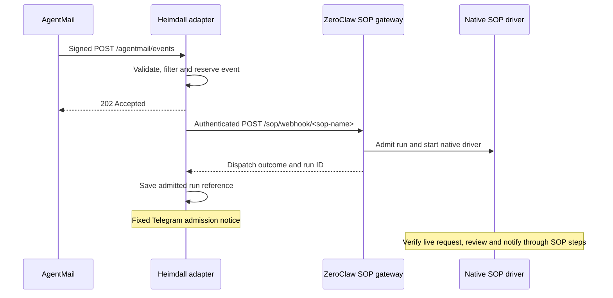

# Webhook interfaces and native SOP dispatch

This describes the local source implementation, not a live deployment. See [AgentMail events](agentmail-events.md) for variables, migration, filter syntax and recovery.

## Different webhook contracts

| Interface | Purpose | Reply |
| --- | --- | --- |
| Gateway `POST /webhook` | Authenticated general agent invocation; also supports upstream SOP-first dispatch | Non-streaming chat waits for the agent result; not used by this adapter |
| Webhook channel (`channels.webhook`) | Separate generic inbound/outbound message channel | Accepts messages for channel processing, optionally POSTing replies elsewhere |
| Gateway `POST /sop/<path>` | Native, authenticated SOP-only webhook admission | Dispatch results and run IDs; agent steps run through the native background driver |
| Heimdall `POST /agentmail/events` | Signed email event filtering and durable duplicate prevention | 202 after reservation; processing admission happens in the background |

The [upstream channel documentation](https://github.com/zeroclaw-labs/zeroclaw/blob/master/docs/book/src/channels/webhook.md) distinguishes the channel from gateway `/webhook`. A channel could connect an internal chat UI or monitoring system using sender/content/thread messages and a reply callback, but it is not necessary for this SOP integration. Upstream master can differ from [the pinned runtime](../deploy/bot/runtime.lock.json); inspect pinned source and contracts when upgrading.

## Current flow

Non-secret rules live in `[[heimdall.agentmail.filters]]` in the embedded template; the launcher removes that section from rendered ZeroClaw configuration. Railway holds credentials, not filter definitions. The `/sop/webhook/` prefix is a provider-independent convention within the native `/sop/*` route, not a new upstream endpoint. Email authentication and parsing remain provider-specific.

The adapter sends matched rule names and bounded inbox/message identifiers, not a chat prompt, subject or email body. Distinct assigned SOP names are deduplicated per event. The installed SOP's explicit agent ownership determines execution; Telegram's current model selection does not configure this driver.

SOP definitions require an exact Webhook trigger matching `/sop/webhook/<sop-name>`. A Manual trigger alone does not work. Native admission applies untrusted-content screening and approval policy. The procedure must verify current GitHub review state and treat retrieved email as data, not authority. See [manifest migration](agentmail-events.md#required-sop-manifest-change).

## Why the timeout patch is removed

Previously, the adapter called `/webhook?agent=primary` and waited for the final agent response before forwarding it to Telegram. That required the local timeout patch to avoid the ordinary 30-second gateway deadline.

Native `/sop/*` starts the agent-step driver and returns admission results instead. The adapter no longer needs a ten-minute synchronous response, so `webhook-timeout.patch` and its Docker application, release manifest and provenance entry are removed. Synchronous `/webhook` reverts to upstream timeout behavior. Other local patches remain for unrelated policy and diagnostics.

The ordinary upstream gateway deadline is 30 seconds; the adapter uses a 35-second HTTP request budget per SOP admission and a separate 20-second Telegram notification budget. These are ceilings, not intentional delays. Native admission may execute deterministic work before returning, so this is not a promise of immediate admission. A timeout can still leave work already started.

[Svix recommends](https://www.svix.com/resources/webhook-university/reliability/webhook-timeout-best-practices/) acknowledging external events quickly and performing expensive processing separately. The AgentMail connection is acknowledged separately from SOP execution. Bounded verification, persistence and optional body retrieval still precede acknowledgement; subsecond latency is not guaranteed.

## Admission is not execution completion

The adapter accepts only one matching result for the assigned SOP with status `started` or `coalesced` and a bounded run ID. A 200 response alone does not imply success: skipped/deferred, malformed, unexpected or missing results are treated as failures. Native blocked results and missing triggers are also failures.

Confirmed admissions are persisted one at a time before later dispatches and Telegram delivery. `mail__filters` exposes recent run references. A later failure does not erase earlier admissions, and dispatching several SOPs is not atomic. The adapter does not poll completion or automatically forward final results; the SOP must include success/failure notifications using already authorized messaging capabilities. Historical `accepted` ledger entries may describe the previous synchronous implementation; do not infer new semantics for old records.

The reservation ledger is not a durable retry queue. Process interruption can leave reserved or uncertain events; automatic replay remains suppressed. Run IDs improve inspection but do not guarantee completion or restart recovery. Inspect native SOP status and actual GitHub/Telegram state before manually retrying. Never clear reservations simply to obtain redelivery.

## Public exposure and authentication

The existing public listener proxies gateway routes to the loopback ZeroClaw server. Both `/webhook` and `/sop/*` remain reachable through that listener, protected by native pairing and the configured optional webhook secret. Route reachability does not grant anonymous execution. The adapter supplies its internal credentials; email senders receive none of them.

AgentMail must target `/agentmail/events`, where its signature, sender/content rules and duplicate reservations are checked. Direct authenticated `/sop/*` calls do not apply the email adapter's filters. No public route, credential, tool grant or pairing policy is added by this change. Dashboard, WebSocket and ACP forwarding remain as before.

## Implementation and validation boundary

- [Adapter source](../launcher/src/agentmail.rs) and [tests](../launcher/src/agentmail/tests.rs): signature admission, dispatch shape, safe results, persistence, diagnostics and replay suppression.
- [Configuration](../deploy/bot/config.template.toml): SOP subsystem and gateway pairing policy.
- [Build recipe](../deploy/bot/Dockerfile): pinned runtime and remaining patches.
- [Native upstream SOP fan-in](https://github.com/zeroclaw-labs/zeroclaw/blob/c473221313341a853e04122f93bb9bd26b5e6c47/docs/book/src/sop/fan-in/webhook.md): exact trigger/auth semantics for this pinned source.

Local HTTP fixtures establish the adapter contract, not live SOP execution. Native Linux build validation and a synthetic deployed event with the migrated SOP are still required before claiming end-to-end compatibility. This local work does not change installed SOP definitions, replay events or deploy an image.
